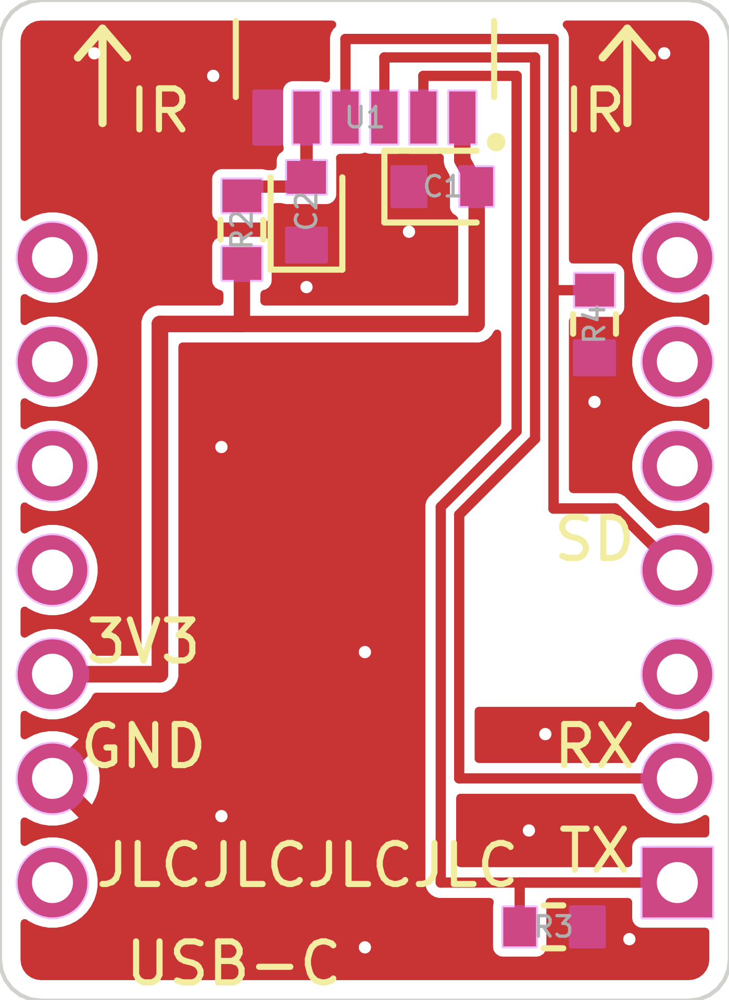
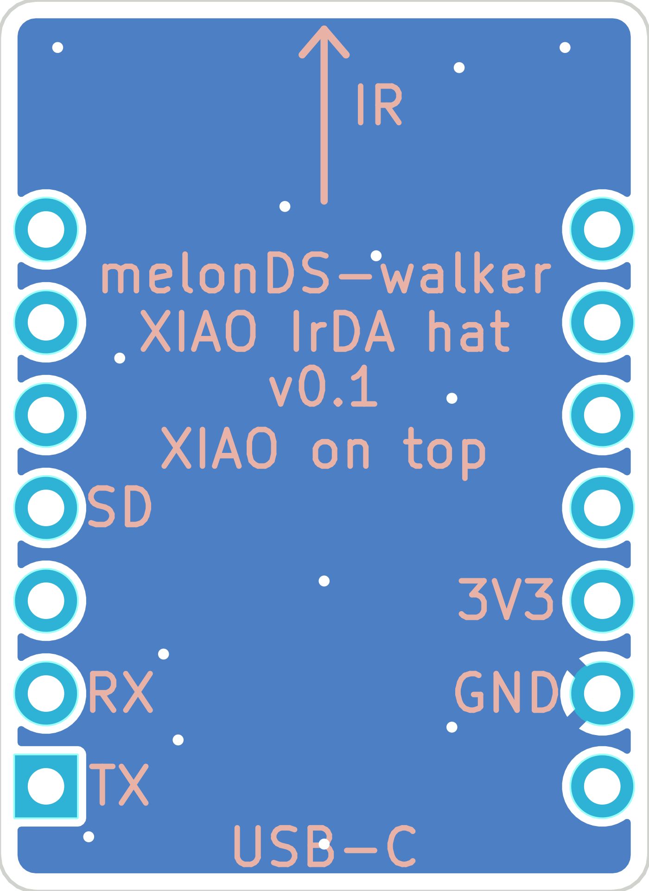
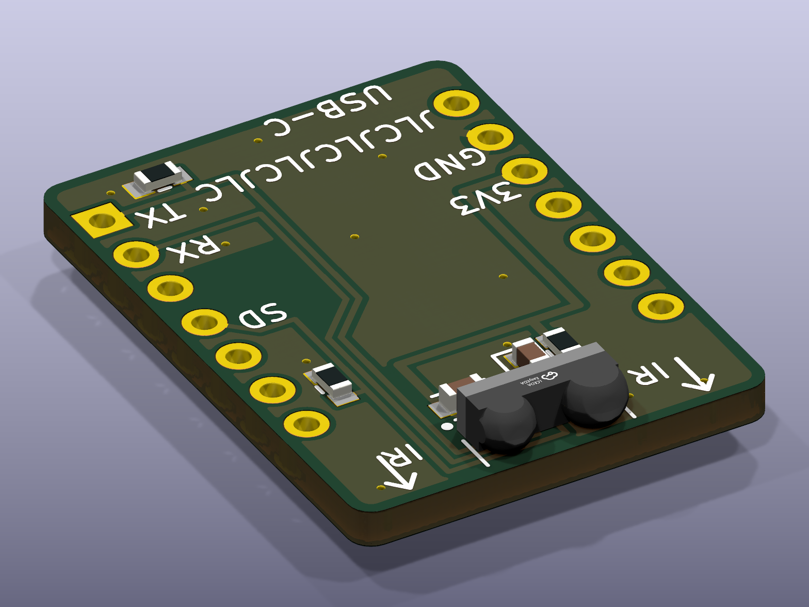

# XIAO IrDA hat (v0.1)

A 17.8 x 24.4 mm, 2-layer carrier for a Seeed Studio XIAO ESP32S3 that holds a Vishay TFBS4711 IrDA SIR transceiver. It is the recommended way to build the melonDS-walker dongle. The XIAO sits on top on two 1x7 headers. The transceiver looks out of the end opposite the XIAO's USB-C connector, so with the dongle plugged into a handheld you aim the Pokéwalker at the far end.

Status: designed, DRC-clean and netlist-checked. **Not yet built or tested.** Read the [pre-order checklist](#pre-order-checklist-human-checks) before you pay for anything.

| Top (XIAO side) | Bottom (outside face) | 3D, factory-assembled |
|---|---|---|
|  |  |  |

Schematic: [renders/schematic.png](renders/schematic.png). 3D views: [renders/3d-top.png](renders/3d-top.png) and [renders/3d-bottom.png](renders/3d-bottom.png). The 3D renders hide the headers because they are marked do-not-populate; `board.step` includes them.

## Design summary

- **Stacking: the hat sits under the XIAO.**
  - The XIAO's BOOT and RESET buttons, its LEDs and the USB-C receptacle are all on its top side, so a hat on top would bury the buttons you need to recover a bad flash.
  - The XIAO's underside has only flat pads: 8 test pads (JTAG/EN/USB) near the USB end, the BAT+/BAT- pads and a logo (Seeed's board file shows no bottom-side parts).
  - Standard male headers leave a 2.54 mm gap (the header plastic) between the hat and the XIAO. That clears the 0603 parts (0.45 to 0.8 mm tall) under the XIAO's far end.
- **IR edge.**
  - The TFBS4711-TR1 is side-view. Its lens tips sit 0.1 mm inside the board edge at the end opposite USB-C, with the whole body inside the outline.
  - The hat runs 3.3 mm past the XIAO's far edge, so the package (back face 0.68 mm beyond the XIAO edge: 11.27 mm against the XIAO's far edge at 10.594 mm from the header centre) is fully outside the XIAO's shadow and nothing is above it.
  - The pads are 2.2 mm from the edge, so copper stays well over 0.3 mm from the edge everywhere; the optical part needed no exception.
- **Keep-out under the battery pads.** No top copper sits under the XIAO's BAT+/BAT- pads (plus 0.5 mm margin), so a wire soldered there later cannot short anything on the hat. The keep-out runs east to just short of the J1 pads so it leaves no thin sliver of pour.
- **Routing: everything is explicit, no autorouter.**
  - TXD, RXD and SD leave their pads from the inner end, under the package body between the pads and the lenses, and exit east.
  - That nests them in the same order as the XIAO's D0, D1 and D3 pins, so the three signals need no crossings and no vias.
  - Power (VCC2, VCC1, GND) leaves the outer pad ends. The bottom layer is an unbroken GND plane apart from vias.
- **Board:** 2 layers, 1.6 mm FR-4, 1 oz, lead-free HASL, GND pour on both layers, 13 tented GND vias. HASL is fine at 0.95 mm pitch; ENIG would buy nothing but cost. 1.6 mm (not 1.0 mm) because the dongle hangs off a USB port.
  - Rules (JLCPCB 2-layer capability with margin): 0.2 mm clearance and minimum track (signals 0.25 mm, power 0.3 to 0.4 mm), 0.3 mm via drill / 0.6 mm pad, 0.3 mm copper to edge (pours 0.5 mm), silkscreen at least 0.15 mm strokes and 1.0 mm text (JLCPCB minimums), at least 0.3 mm from the outline.

### Circuit and part values

The circuit is Vishay's recommended circuit (datasheet Fig. 1 / Table 1). FlippIR uses the same topology and values.

| Ref | Value | Why |
|---|---|---|
| U1 | TFBS4711-TR1 | Side-view taping, same part as FlippIR/Flipwalker. Alternate: TFBS4711-TR3 (C3171514), also side-view. |
| C1 | 10 µF 10 V X5R 0603 | Datasheet C1: buffers the IRED supply at VCC2 (pin 1) for the up to 430 mA LED pulses; "tantalum or other fast capacitor", and ceramic qualifies. 10 µF rather than 4.7 µF because DC bias at 3.3 V leaves only part of the nominal value (see REVIEW.md, NIT 3). |
| C2 | 100 nF 50 V X7R 0603 | Datasheet C2: VCC1 (pin 5) decoupling, placed right at the pins as the datasheet insists. |
| R2 | 47 Ω 0603 | Datasheet R2: with C2 forms the VCC1 low-pass filter. Drop is under 0.1 V at the 2 mA worst-case dynamic current. |
| (R1) | not fitted | Datasheet R1 is optional and only reduces LED intensity. The TFBS4711 regulates its own IRED current (200 to 430 mA) with no resistor, and we want full range. VCC2 goes straight to 3V3, as on FlippIR. |
| R3 | 10 kΩ 0603, TXD to GND | Keeps the LED dark while GPIO1 floats (reset, ROM bootloader, before the firmware runs). Value below. |
| R4 | 10 kΩ 0603, SD to GND | SD default. See below. |

- **Why 10 k, not FlippIR's 100 k.**
  - The datasheet allows up to 10 µA input leakage on TXD and SD, and only guarantees a low input below 0.4 V.
  - 100 kΩ x 10 µA = 1 V, which is not a guaranteed low; 10 kΩ gives 0.1 V or less.
  - The ESP32-S3 has no internal pull on GPIO1, 2 or 4 at reset (S3 datasheet Table 2-1), so the external resistor alone sets the level.
  - The cost is 0.33 mA while a pin is driven high: during the 1.6 µs TX pulses, or while the host has shut the transceiver down. That doesn't matter for a USB-powered dongle.
- **Why SD is pulled down (transceiver enabled by default).**
  - It matches the firmware. `config.h` defaults `IR_PIN_SD` to GPIO4, and `ir_uart.cpp` drives SD low (enabled) as part of init; it only raises SD when the host sends the disable command. It also matches `-DIR_PIN_SD=-1` builds and other firmware that never touches SD.
  - The datasheet says SD must be grounded for normal operation.
  - It is safe at boot: with SD low the receiver is simply on and drives RXD into GPIO2, an input and not a strapping pin. The LED cannot fire because R3 holds TXD low. Even a stuck-high TXD is cut off by the chip's 100 µs TXD protection.
  - A pull-up would only save the transceiver's 70 µA idle current during boot.

## Pinout

| XIAO pin | XIAO name | ESP32-S3 | Hat net | TFBS4711 pin | Firmware |
|---|---|---|---|---|---|
| 1 (J1.1, square pad) | D0 | GPIO1 | TXD | 2 TXD | `IR_PIN_TX 1` |
| 2 (J1.2) | D1 | GPIO2 | RXD | 3 RXD | `IR_PIN_RX 2` |
| 4 (J1.4) | D3 | GPIO4 | SD | 4 SD | `IR_PIN_SD 4` |
| 12 (J2.5) | 3V3 | 3V3 out | V3V3 | 1 VCC2 (IRED anode), and 5 VCC1 via R2 | |
| 13 (J2.6) | GND | GND | GND | 6 GND | |
| 3, 5, 6, 7, 8, 9, 10, 11, 14 | D2, D4 to D10, 5V | | not connected (holes only, for mechanical strength) | | |

The firmware defaults need no change: `pio run -e seeed_xiao_esp32s3`.

## BOM

Factory-assembled parts, one hat. Library type, stock and price are from JLCPCB's part pages, queried 2026-11-06. Stock moves, so re-check before ordering.

| Ref | Comment | Footprint | LCSC | JLCPCB library | Stock | Unit price (1+) |
|---|---|---|---|---|---|---|
| U1 | TFBS4711-TR1 | TFBS4711 side view | [C102624](https://jlcpcb.com/partdetail/C102624) | **Extended** | 40 | $6.98 |
| (U1 alt) | TFBS4711-TR3 | same | [C3171514](https://jlcpcb.com/partdetail/C3171514) | Extended | 47 | $6.60 |
| C1 | 10 µF 10 V X5R (Samsung CL10A106KP8NNNC) | 0603 | C19702 | Basic | in stock at review (re-check) | re-check |
| C2 | 100 nF 50 V X7R (Yageo CC0603KRX7R9BB104) | 0603 | C14663 | Basic | 34.7 M | $0.009 |
| R2 | 47 Ω 1 % (UniOhm 0603WAF470JT5E) | 0603 | C23182 | Basic | 1.4 M | $0.002 |
| R3, R4 | 10 kΩ 1 % (UniOhm 0603WAF1002T5E) | 0603 | C25804 | Basic | 42.8 M | $0.002 |

Not assembled, hand-soldered by you: J1 and J2, two 1x7 2.54 mm male pin headers (standard 2.54 mm plastic, 6 mm/3 mm pins; often supplied with the XIAO). They are excluded from `fab/bom.csv` and `fab/cpl.csv` (KiCad "exclude from BOM/position files" plus DNP).

### Estimated JLCPCB cost (5 assembled boards, Economic PCBA)

| Item | Estimate |
|---|---|
| 5 PCBs, 2-layer, 1.6 mm, HASL, green | about $2 to 4 |
| PCBA setup + stencil | $8.18 + $1.53 |
| Extended feeder loading (TFBS4711 only; all passives are Basic) | $1.50 to 3.07 (sources disagree; the live quote decides) |
| SMT joints (16 per board) and confirm-placement | about $1.90 |
| Parts: 5 x TFBS4711 at about $6.98, plus passives under $0.50 | about $35.40 |
| **Subtotal before shipping and duty** | **about $50 to 55** |
| Shipping (DHL/FedEx/UPS) plus US import duty | about $20 to 40 (unverified, varies) |

Landed: roughly $70 to 95. The TFBS4711 is now about twice the price the earlier research assumed (it found $3.21). To save about $21, assemble only 2 of the 5 boards; Economic PCBA allows an assembly quantity of 2. Fees are from JLCPCB's price page as recorded in `projects/radio/reports/PCB design tools and fab houses.md`. Prices are not from a live quote.

## Footprint check: datasheet vs LCSC import vs this board

The TFBS4711 footprint is drawn in `index.circuit.tsx` from the datasheet (Vishay 82633 rev. 3.9, Fig. 3 and Fig. 4 "side view application"). `easyeda2kicad --lcsc_id C102624 --full` was used as a cross-check; its output is kept in `footprints/` (LCSC/EasyEDA footprints are not CC-BY-SA).

| Check | Datasheet (side view) | EasyEDA C102624 import | This board |
|---|---|---|---|
| Pads | 6 | 6 | 6 |
| Pitch | 0.95 mm (5 x 0.95 = 4.75) | 0.95 (one gap 0.96 from rounding) | 0.95 |
| Pad size | 0.64 x 1.27 mm | 0.64 x 1.524 mm | 0.64 x 1.27 mm |
| Pad position vs body | pads stick out 0.4 mm behind the back face | 0.50 mm (pad centre 0.26 in front of the back face) | 0.4 mm (pad centre 0.235 in front) |
| Pin order (seen from top, lenses toward you) | 1 VCC2 at left (emitter side) ... 6 GND at right | pin 1 at -X, emitter arc on the pin-1 side | same frame as EasyEDA; placed at 180°, so pin 1 is at +X with the lenses toward the IR edge |
| Optical face | lenses on the side opposite the pads, 3.0 mm from the back face | courtyard to +2.74 mm from pad centre | lens tips 2.765 mm from pad centre, 0.1 mm inside the board edge |
| Body | 6 x 3 x 1.9 mm (±0.2) | courtyard 6 x 3 mm | courtyard 6.5 x 3.6 mm, clipped at the edge |
| 3D model | | STEP is the right shape but half sunk (z ±0.95) and 0.665 mm too far back | offset corrected to (0, -0.665, +0.95) mm; `board.step` places the body at the datasheet position |

Verdict: the EasyEDA footprint is the side-view land pattern with correct pin order and orientation. It differs only in pad length (+0.25 mm), which is harmless. This board uses the datasheet's exact pad, and keeps the EasyEDA orientation so the JLCPCB rotation is just the board rotation (180°). `verify_netlist.py` re-checks U1 on the fab board: 6 pads of 0.64 x 1.27 mm, 0.95 mm pitch, pin 1 at the expected end, and lens tips 0 to 0.3 mm inside the IR edge (actual 0.10 mm).

Other footprints:
- **0603 R/C:** tscircuit's built-in `0603` is two 0.8 x 0.95 mm pads at ±0.825 mm. That is identical to KiCad's `R_0603_1608Metric` / `C_0603_1608Metric` (IPC-7351 nominal).
- **Headers:** drawn in `index.circuit.tsx` as plated holes, 1.0 mm drill and 1.7 mm pad, the same land as KiCad's `PinHeader_1x07_P2.54mm_Vertical`. Seeed's carrier footprint uses 0.889/1.524 mm; 1.0 mm is easier to hand-solder and still holds a 0.64 mm square pin.

## Dimension sources

| Dimension | Value | Source |
|---|---|---|
| XIAO header rows | 2 x 7 holes, 2.54 mm pitch, rows **15.24 mm** apart (x = ±7.62 from centre), pin 1 = D0 at the USB end | Seeed [OPL_Kicad_Library](https://github.com/Seeed-Studio/OPL_Kicad_Library/tree/master/Seeed%20Studio%20XIAO%20Series%20Library), `XIAO-ESP32-S3-DIP.kicad_mod` (pads at ±7.62, ±7.62), and the castellated-pad positions in `Seeed Studio XIAO ESP32S3/ESP32S3.kicad_pcb`. Dimensions only; no Seeed (CC-BY-SA) files are in this repo. The 17.78 mm spacing quoted in the earlier research is wrong. |
| XIAO pin map | D0 = GPIO1, D1 = GPIO2, D3 = GPIO4, pin 12 = 3V3, 13 = GND, 14 = 5V | [Seeed wiki, XIAO ESP32S3 pin map](https://wiki.seeedstudio.com/xiao_esp32s3_getting_started/); OPL symbol `XIAO-ESP32-S3-SMD` (12 3V3_OUT, 13 GND, 14 VBUS) |
| XIAO outline | 17.78 x 21.0 mm; edges at about -10.55 (USB end) and +10.6 (far end) from the header-field centre; USB-C overhangs about 1.5 mm | Seeed wiki spec (21 x 17.8 mm); `XIAO-ESP32-S3-DIP.kicad_mod` courtyard (x -10.425..10.55); `ESP32S3.kicad_pcb` Edge.Cuts |
| XIAO bottom pads | BAT+ (-0.381) and BAT- (-2.286) at 4.445 mm toward the D0 side, 2.03 x 1.02 mm; 8 test pads at ±1.27 mm, -8.64 to -1.02 mm (USB end) | `ESP32S3.kicad_pcb` bottom footprints BAT0, GND0, TP1 to TP8; `XIAO-ESP32-S3-SMD.kicad_mod` pads 15 to 25 |
| Hat outline | 17.8 x 24.4 mm, x ±8.9, y -10.5 (USB end, flush with the XIAO) to +13.9, 1 mm corner radius | derived from the rows above |
| TFBS4711 land pattern | see footprint check | [Vishay TFBS4711 datasheet 82633 rev. 3.9](https://www.vishay.com/docs/82633/tfbs4711.pdf), Fig. 3 and Fig. 4 |
| TFBS4711 circuit | C1 4.7 µF (this board uses 10 µF for DC-bias margin), C2 100 nF, R2 47 Ω, R1 optional; TXD protection 100 µs; input leakage ≤10 µA; VIL ≤0.4 V | same datasheet: Fig. 1, Table 1, pin table, electrical characteristics |
| ESP32-S3 reset state | GPIO1 and GPIO2 input with no pull, GPIO4 disabled with no pull; 60 µs low glitch at power-up | [Espressif ESP32-S3 datasheet v2.2](https://www.espressif.com/sites/default/files/documentation/esp32-s3_datasheet_en.pdf), Tables 2-1 and 2-2 |

### Heights, for the enclosure (`board.step`)

- Hat PCB 1.6 mm, parts on top only.
- Header plastic: 2.54 mm, so the XIAO's underside sits **4.14 mm** above the hat's bottom face. Header pins stick out about 3 mm below the hat; trim them flush.
- TFBS4711: 1.9 mm tall. Lens axis 0.95 mm above the hat's top face (2.55 mm above its bottom face), centred on x = 0. Lens tips at y = 13.8 mm, board edge at 13.9 mm.
- Enclosure IR window: at least 6 x 2.5 mm, centred on the lens axis. Half-intensity angle is ±24°.
- `board.step` holds the hat, its SMD parts and both headers. It does not include the XIAO; add Seeed's model on the header plastic at z = 4.14 mm.

## Verification

- **DRC:** `kicad-cli pcb drc --refill-zones`, with the JLCPCB rules above: **0 errors, 0 warnings, 0 unconnected** ([renders/drc-report.txt](renders/drc-report.txt)).
  - Waived: only `lib_footprint_issues` and `lib_footprint_mismatch` are set to ignore in `kicad/xiao-irda-hat.kicad_pro`. These footprints are generated, not taken from a KiCad library, so the library-link checks do not apply.
- **Fab package (independent of the exporters):** `scripts/gerber_netcheck.py` reads `fab/gerbers.zip`, rasterizes both copper layers, joins them through the plated holes and asserts the intended nets by physical pad location, the J1/J2 header geometry (15.24 mm rows, 2.54 mm pitch, D0 = J1.1 at the USB end, 3V3 = J2.5, GND = J2.6, 5V = J2.7 unconnected), and the BOM/CPL (LCSC numbers, U1 at 180°, headers excluded). `scripts/silk_check.py` checks silkscreen strokes (>= 0.15 mm), text height (>= 1.0 mm), silk over pads and silk clearance to the outline (>= 0.3 mm). Both run through `pcb-env/bin/py`; `gerber_netcheck.py --self-test` shows they fail on deliberately broken copies.
- **Netlist:** `python3 verify_netlist.py` checks all 30 pins of the 8 parts against an explicit net table, in both tscircuit's `circuit.json` and the fab KiCad board. It also checks that `firmware/src/config.h`'s GPIO defaults land on the header pins the table says, and checks U1's land pattern and its distance to the IR edge. It passes, and it was checked to fail on a swapped resistor, a moved pad net and a changed firmware pin.

## How to rebuild

Everything runs from the host through the wrappers in `bin/` of the pcb-env distrobox environment (`~/projects/radio/pcb-env`, see its README); a bare `tsci` will not work.

```sh
PCB_ENV=~/projects/radio/pcb-env hardware/xiao-irda-hat/scripts/build.sh
```

| Step | Tool | Output |
|---|---|---|
| 1 | `tsci build` / `tsci export` of `index.circuit.tsx` | `dist/index/circuit.json`, `build/export.kicad_pcb`, `build/export.kicad_sch` |
| 2 | `scripts/kicad_postprocess.py` (KiCad 10 pcbnew) | `kicad/xiao-irda-hat.kicad_{pcb,pro,sch}` |
| 3 | `kicad-cli pcb drc` | `renders/drc-report.txt` (fails the build on any error) |
| 4 | `verify_netlist.py` | pass/fail |
| 5 | `kicad-cli pcb export svg` / `pcb render`, `rsvg-convert` | `renders/*.png` |
| 6 | `kikit fab jlcpcb --assembly --field LCSC --missingError` | `fab/gerbers.zip`, `fab/bom.csv`, `fab/cpl.csv` |
| 6b | `scripts/gerber_netcheck.py`, `scripts/silk_check.py` | pass/fail on the packaged `fab/` files |
| 7 | `kicad-cli pcb export step` | `board.step` |

Placement, pads, every trace and via, the silkscreen, the outline and the keep-out all live in `index.circuit.tsx`. The post-processing step adds only what tscircuit's KiCad export does not carry over, and the script header lists each change:
- deletes empty placeholder footprints the exporter emits for named vias;
- solder paste equal to the pad;
- 0.4 mm refdes moved to the fab layer;
- 3D models;
- the GND zones rebuilt as KiCad zones with thermal reliefs, plus a KiCad rule area for the keep-out;
- design rules, title block, and schematic fields for KiKit.

The KiCad board in `kicad/` opens in the KiCad GUI for human review.

## How to order at JLCPCB

Do not order until the [checklist](#pre-order-checklist-human-checks) is done.

1. On jlcpcb.com, **Order now** and upload `fab/gerbers.zip`. Check the detected size (17.8 x 24.4 mm) and 2 layers, and look at the Gerber viewer: the IR edge, the TFBS pads and the bottom text.
2. PCB options:
   - Base material FR-4, 2 layers, **PCB Qty 5**, Product type: industrial/consumer.
   - Delivery format: single PCB. Thickness 1.6 mm. **Colour green.** Economic PCBA is greyed out for some colours (red, for one), and with it greyed out the page falls back to Standard PCBA, which adds edge rails on every side. Silkscreen white.
   - Surface finish **LeadFree HASL** (or HASL with lead). **Not OSP**, which is now JLCPCB's default and also blocks Economic PCBA. Outer copper 1 oz. Via covering: tented.
   - **Mark on PCB: "Remove Mark".** As of November 2026 the page offers only "Remove Mark" or "2D barcode", with no "Specify a location". The board's `JLCJLCJLCJLC` placeholder then prints literally, hidden under the XIAO. The v0.1 boards were ordered this way. (A later rebuild may drop the placeholder.)
   - Enable **"Confirm Production File"** and inspect JLCPCB's panel before production. Reject any rails, tabs, V-scores or tooling holes on the IR edge (the short edge opposite USB-C); rails or tabs on the two long edges are fine.
   - Leave everything else at the default.
3. Turn on **PCB Assembly**:
   - PCBA type **Economic**. Assembly side **Top**. **PCBA Qty 5** (or 2 to save money).
   - Tooling holes: "Added by JLCPCB". Confirm parts placement: **Yes** ($0.45; an engineer checks orientation).
   - Order remark: *"Please keep panel tabs / mouse bites off the edge with the IR transceiver U1 (the short edge opposite the header pin 1 / USB-C end). U1 is a side-view optical part flush with that edge."*
4. **Next:** upload `fab/bom.csv` (BOM) and `fab/cpl.csv` (pick-and-place). There should be 6 placed parts: U1, C1, C2, R2, R3, R4. J1/J2 are not in the files on purpose.
5. Parts matching: confirm each line shows the LCSC number in the BOM, with stock for 5 boards (plus attrition).
   - If C102624 (TFBS4711-TR1) is short, switch U1 to **C3171514** (TFBS4711-TR3, same side-view taping, same footprint).
   - Only U1 should be Extended.
   - Stock: about 40 x TR1 (C102624) at JLCPCB when last checked, so order soon. C3171514 (TR3) is the alternate.
6. **Placement preview: check U1's rotation and position.**
   - **Quick check:** with the IR edge at the top of the preview, the lenses point up (toward the edge) and the pin-1 marker is at the right-hand end of the pad row, next to C1. A 180° error would put 3V3 on the GND pad.
   - The two round lenses must face **outward, flush with the board edge farthest from the USB-C end** (the edge with the "IR" arrows). The flat back with the 6 terminals faces the passives.
   - The terminals must sit on the 6 pads.
   - If the part points into the board, set U1 rotation to 0° in the preview (or add a `JLCPCB_CORRECTION` field `0;0;180` to U1 and rebuild). If it is shifted by about 1.3 mm along the lens axis, JLCPCB's model origin is the body centre rather than the pad row; correct the offset in the preview.
   - Also glance at the five 0603 parts (rotation doesn't matter electrically).
7. Review the quote, then pay. The DDP duty line and shipping method appear at checkout.

## Hand-soldering the headers

1. The XIAO goes on **top** of the hat, component side up, its USB-C at the hat's "USB-C" end (the end with the square pad, J1.1 = D0). The transceiver end sticks out past the XIAO's far edge.
2. Keep the **2.54 mm header plastic between the boards**. Do not mount the XIAO flush: the passives under its far end need the gap.
3. Easiest order:
   - Put the long pins of two 1x7 headers through the XIAO from below (plastic against the XIAO's underside) and solder them on the XIAO's top.
   - Then drop the short pins into the hat from the top and solder them on the hat's bottom face.
   - If your XIAO came with headers already soldered pins-down, use the same procedure from the second step.
4. Solder all 14 pins; the unused ones carry nothing but add strength. Tack two opposite corner pins first and check that the boards are parallel and the XIAO is square to the hat, then do the rest.
5. GND (J2.6) has thermal reliefs on both pour layers, but still needs a bit more heat than the others. Trim the pins flush on the hat's bottom so the dongle sits flat.
6. Before plugging in, check with a meter: 3V3 (J2.5) to GND (J2.6) is not shorted, and TXD (J1.1) to GND reads about 10 kΩ.

## Assumptions

- The XIAO ESP32S3 (non-Sense) is used. The Sense variant's camera board is on top and does not conflict, but was not checked.
- Standard headers with 2.54 mm plastic. Low-profile or machined-pin headers with a smaller gap would put the XIAO onto C1, C2, R2 and R4. The XIAO's USB-C shell legs sit above R3 (leg S2 overlaps R3 pad 1 in XY), which has about 1 mm of vertical clearance with standard headers, so never use low-profile headers.
- The XIAO's 3V3 regulator can supply the TFBS4711's LED pulses: 300 mA typical, 430 mA max, 1.6 µs long, 3/16 duty during a run of zero bits. That averages about 56 mA typical and 81 mA worst case, inside the datasheet's 85 mA limit for pin 1. C1 supplies the peaks locally.
- JLCPCB's internal footprint for C102624 has the same 0° orientation and origin as the EasyEDA footprint. That's why the CPL says 180° at the pad-row centre.
- No silkscreen refdes on the board; designators are on the fab layer and in the renders. There is no room for 1.0 mm refdes next to every part.
- **The XIAO's USB-C is a receptacle.** The dongle exposes a female port, so plugging it into a handheld needs a short male-to-male USB-C cable or adapter. A right-angle or U-shaped M-M adapter is the compact option.

## Open questions

- **Rotation and origin of U1 at JLCPCB:** unverified until the placement preview. This is the main ordering risk.
- **Stock:** 40 x TR1 and 47 x TR3 at JLCPCB on 2026-11-06. A reorder from this repo may find both gone; Digi-Key/Mouser plus hand or hot-air assembly is the fallback.
- **Panel tabs:** Economic PCBA may ship panelized with mouse bites. A tab on the IR edge would leave a nub of up to about 0.5 mm in front of the lenses (file it off). The order remark asks JLCPCB to avoid it.
- **Signals under the package:** TXD, RXD and SD run under the TFBS4711 body, mostly under the emitter half; the detector half only has the start of the SD stub. Vishay's layout note asks only for short, low-inductance supply wiring, and none of these is a supply. I expect no effect but it is untested.
- **Firmware comment (fixed):** `config.h`, `firmware/README.md` and `docs/hardware.md` now give the TFBS4711 TXD watchdog as 100 µs (the TFDU4101's is 50 µs).

## Pre-order checklist (human checks)

1. Open `kicad/xiao-irda-hat.kicad_pcb` in the KiCad GUI once. Look at the TFBS4711: lenses at the edge, pin 1 (dot) next to C1.
2. Compare the TFBS4711 pads against datasheet Fig. 4 yourself (0.95 mm pitch, 0.64 x 1.27 mm, 0.4 mm behind the back face).
3. Hold a XIAO against `renders/pcb-top.png` printed at 1:1 (17.8 mm wide), or measure your XIAO: rows 15.24 mm apart, pin 1 at the USB end on the D0 side.
4. Check live stock and Basic/Extended status for all six LCSC numbers.
5. In the JLCPCB placement preview: U1 rotation and position (step 6 above).
6. Read the quote's duty and shipping lines.

## Files

| Path | What |
|---|---|
| `index.circuit.tsx` | the board, in tscircuit |
| `package.json` | project metadata for `tsci` (no npm dependencies; tscircuit comes from pcb-env) |
| `scripts/build.sh` | end-to-end rebuild |
| `scripts/kicad_postprocess.py` | tscircuit KiCad export to fab-ready KiCad board |
| `verify_netlist.py` | pin-by-pin netlist check (exporter data) |
| `scripts/gerber_netcheck.py`, `scripts/silk_check.py`, `scripts/gerblib.py` | gerber-level connectivity, BOM/CPL and silkscreen checks on `fab/` |
| `footprints/` | easyeda2kicad import of C102624 (symbol, footprint, STEP/WRL), the cross-check reference and the 3D model source |
| `kicad/` | generated, fab-ready KiCad board, project (rules) and schematic |
| `fab/` | `gerbers.zip`, `bom.csv`, `cpl.csv` for JLCPCB |
| `renders/` | PCB top/bottom, tscircuit view, schematic, 3D renders, DRC report |
| `board.step` | 3D model of the assembled hat with headers, for the enclosure |
